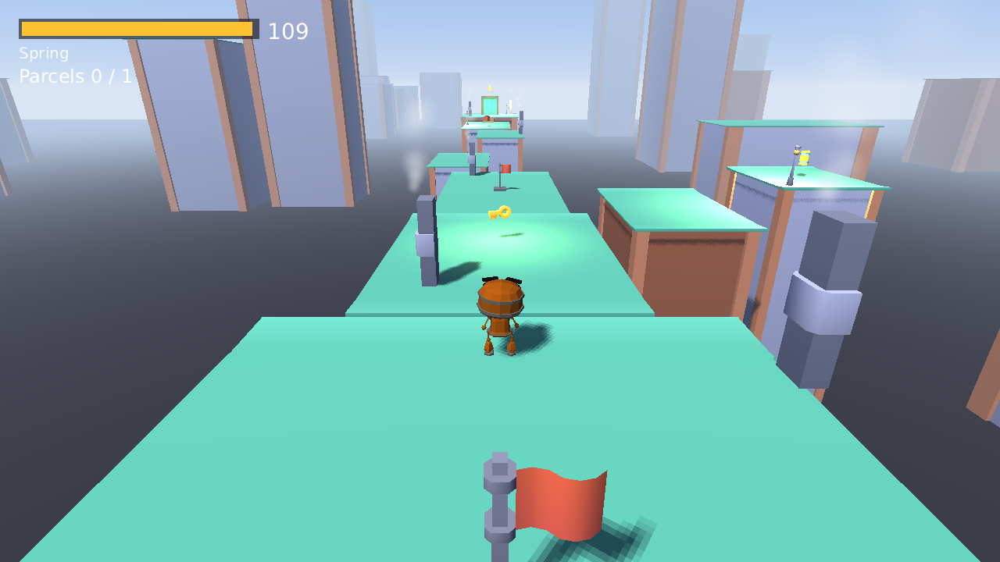
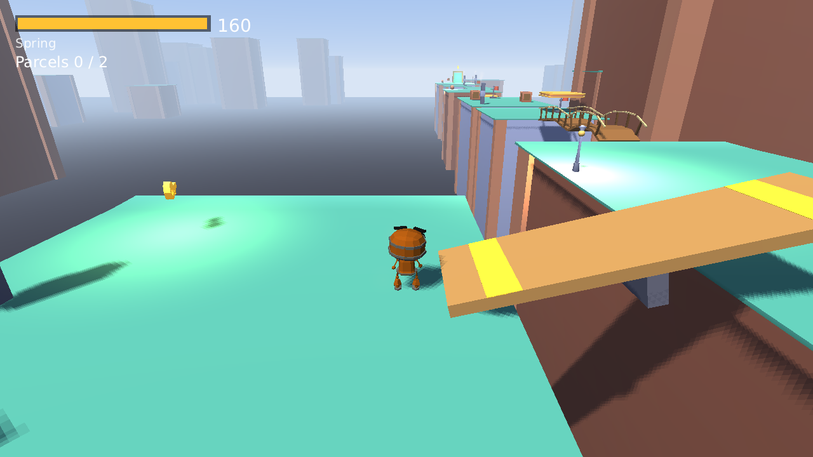
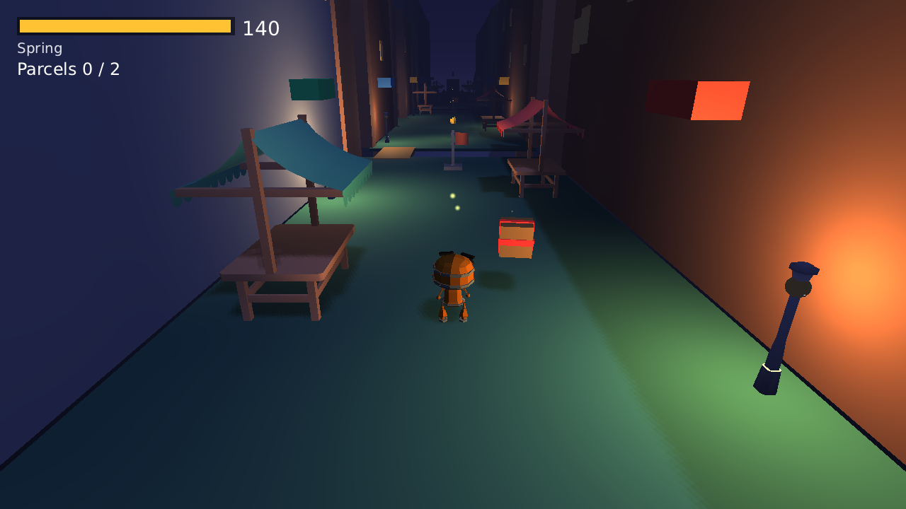
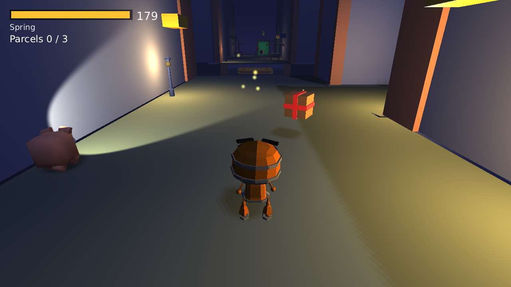

# Clockwork Courier

A 3D mobile-first game about a wind-up robot courier who delivers parcels before its spring runs down. It is the
second reference game of the FactorIA engine (milestone M25), built in seven packages: the playable core (P1), the
world: six levels in two districts, guard dogs, physics props, music and particles (P2), progress, profile and saves
(P3), store services (P4), mobile comfort and accessibility (P5), shipping (P6, `SHIPPING.md`) and Spanish and Japanese
(P7). The later packages build on the contracts below.

## Run

```bash
factoria validate
factoria run                      # windowed
factoria run --headless --frames 120 --screenshot-at 119 --json
factoria test                     # 444 headless tests (the six levels are played by a bot)
```

The title screen (`scenes/main.scene.json`) goes through Play and `scenes/loading.scene.json` to the first level of the
list (`rooftops_1`). The test yard (`scenes/test_yard.scene.json`) and the prop arena (`scenes/test_arena.scene.json`)
stay loadable for tests but are not in the player's list.

## Controls

| Action | Keyboard | Gamepad | Touch |
|---|---|---|---|
| Move (camera-relative, analog) | WASD / arrows | left stick | on-screen stick, bottom-left |
| Walk instead of run | hold Shift | push the stick gently | push the stick gently |
| Jump (about 1.2 m, coyote time and jump buffer) | Space | A | Jump button |
| Action (pull a lever) | F | X | Act button |
| Orbit the camera | Q / E, mouse drag | right stick | one-finger drag on free screen |
| Zoom (3 to 10 m) | R / V, mouse wheel | shoulders | two-finger pinch |
| Pause | Escape / P | Start | pause button, Android Back |

The touch controls appear on the first touch and hide again when a keyboard or gamepad is used; they respect the
safe area (notches).

## The levels

Two districts, three levels each. Every level has a main route that delivers every parcel (also the optional one) and
an expert shortcut (a longer jump, a ledge, a bridge skipped). Times are what the autoplay bot needs; a new player
should take two to three times as long. Stars: 1 for delivering, 2 with one bonus goal, 3 with two or more. The
bonus goals are `fast` (within `parTime`), `springy` (at least 25 percent of the spring left) and `thorough` (every
optional parcel delivered).

| Level | Name | Spring | Par | Bot main / shortcut | What is in it |
|---|---|---|---|---|---|
| `rooftops_1` | First Roofs | 110 s | 50 s | 22 / 18 s | gaps, a key, two checkpoints, an optional parcel, chimney steam |
| `rooftops_2` | Chimney Row | 140 s | 70 s | 31 / 29 s | two parcels, a gate and lever, crates, a dog, a key |
| `rooftops_3` | Clock Square | 200 s | 100 s | 47 / 36 s | a seesaw, a rope bridge, two moving platforms, crates, two dogs |
| `market_1` | Lantern Lane | 130 s | 60 s | 26 / 25 s | night, lantern lights, canals with footbridges, a slalom |
| `market_2` | Stall Street | 170 s | 80 s | 36 / 35 s | a gate and lever, hurdles, a crate puzzle, a dog near the door |
| `market_3` | Midnight Rush | 220 s | 100 s | 45 / 34 s | three parcels, a rope bridge, a gate and lever, a moving platform, two dogs |

The rooftops are by day (sky, fog, sun); the market is at night (14 to 16 point lights from lantern prefabs, emissive
windows and signs, fog, fireflies). Both are built from static boxes and the Kenney Fantasy Town and Platformer kits
(models in `assets/`). Busiest level (market_3): 119 draw calls, 232 meshes (25 culled), about 27 000 triangles and
under 1 ms of CPU per frame headless (`factoria call perf.measure`); market_2 has the most triangles (about 30 000).
Each level keeps under the 32 lights per frame the engine draws.

 
 

The levels are scenes of prefab instances: edit them like any scene (`factoria call scene.format` with `paths`).

## The level objects

| Prefab / script | What it does | Fields (scene props) |
|---|---|---|
| `parcel` (`scripts/parcel.js`) | picked up by touching, carried visibly on the robot's back | `optional` (the bonus parcel) |
| `delivery_door` | hands the parcel in; the level ends when all required parcels are in | |
| `wind_key` | winds the spring, sparks, bell | `seconds` |
| `checkpoint` | flag; the last one touched is the respawn point for a fall or a catch | |
| `gate` + `lever` | hinge gate (`Joint3D` motor) opened and shut by a lever (the Act button) | `openAngle`, `direction`, `closeAfter`; lever `targets`, `once` |
| `seesaw` | a plank on a hinge; the end the courier stands on goes down | `along`, `maxAngle`, `rest` |
| `rope_bridge` | planks chained by hinges, built by the script between two points | `from`, `to`, `planks`, `width`, `sag` |
| `mover` | kinematic moving platform that carries the courier | `offset`, `speed`, `wait`, `phase` |
| `crate` | pushable dynamic crate; thud and scrape sounds | `mass` |
| `dog` (`scripts/dog.js`) | guard dog, see below | `route`, `loop`, `sightRange`, `sightAngle`, `hearRadius`, `alertTime`, `giveUpTime`, `leash` |

### Guard dogs

A dog patrols its route, notices the courier inside its view cone (with a clear line-of-sight ray) or very close when
the courier runs, barks for 0.7 s (`dog_alerted`), then chases at 4.6 m/s (the courier runs at 5) along a path found by
`scripts/nav.js`, and gives up after 5 s without seeing it (`dog_gave_up`) or when it strays 18 m from home. A catch
calls `courier.caught("dog")`: the courier lies down for 1.4 s, pays 5 s of spring, and gets up at the last checkpoint with
1.5 s of safety (`courier.grace`). Walking (Shift or a half-tilted stick, below 2.3 m/s) shortens the sight range to 60
percent and the dog does not hear it: sneaking past a dog is how the levels teach it.

The engine has no navmesh, so `scripts/nav.js` is a lazy grid A* over the physics world (a downward ray for the ground
height, `physics.overlapSphere` for obstacles, step height limit). It serves the dogs and tap-to-move.

### Tap to move

`scripts/tap_move.js` (one `tap_move` entity per level): tap the ground and the courier walks there around obstacles.
Off by default; it is the `tapToMove` field of `settings.load()` and the "Tap to move" switch of Options > Play. The
stick or a jump cancels the walk.

### Comfort and accessibility (P5)

Everything is an option on one of the Options tabs (Video, Audio, Play, Touch, Controls, Language; the Controls tab
is hidden on a phone). Each option is saved at once and applied at once, in the title, in the pause menu and in a level.
`settings.load()` returns the defaults plus the player's saved differences, so a key the player never touched keeps
following the system (`game.accessibility`, the platform).

| Option (`settings` key) | What it does |
|---|---|
| Quality (`quality`: low, medium, high) | Sun shadows, view distance (fog), ambient particle counts and one lantern light in three on low. A phone starts at medium. |
| Frame cap (`frameCap`: 30, 60, 0) | Where the platform lets the game set it (greyed out on a phone, which starts at 30). |
| Color filter (`colorFilter`) | `Camera.colorFilter`: greyscale, high contrast and three kinds of colour blindness. |
| Assist mode (`assist`) | Spring drains at 60 percent, dogs run at 75 percent, give up after half the time, bark 1.6 times longer, coyote time and jump buffer 0.25 s. The numbers are `accessibility.ASSIST`. |
| Reduced motion (`reducedMotion`) | Follows `game.accessibility.reducedMotion` until the player chooses; props stop bobbing and spinning, the camera follows softer, particles and the low-spring pulse stop. |
| Vibration (`haptics`) | `input.vibrate` pulses (`scripts/haptics.js`): a landing, a catch, a delivery, the spring running low. |
| Text size (`textScale`) | `ui.textScale`: 85 to 200 percent; starts from the system's text size. Every screen is checked at 200 percent in the three languages (see "Languages"). |
| Left-handed layout, Control size, Control opacity (`leftHanded`, `controlSize`, `controlOpacity`) | Mirror the touch controls; scale them (0.8 to 1.4) and their distance to the edge; scale their opacity (0.3 to 1). |
| Camera speed, Invert camera Y (`cameraSensitivity`, `invertY`) | Scale the orbit speed (0.4 to 2.5) and flip the tilt. |
| Tap to move (`tapToMove`) | See above. |

Captions: every sound that matters (a key, a delivery, a dog's bark, a catch, the spring running low) is played with
`caption` and `captionKey` (`captions.*` in the locales), drawn by the `Captions` entity inside the safe area, and the
Subtitles option of the Audio tab switches them. The spring-low warning is a yellow triangle with "!" and the word
"Low" next to the bar, so it reads without colour; doors, keys and gates differ by shape (a gate has a diagonal brace, a
key a T handle on a base) and a dog that noticed the courier shows a bright "!" on a dark ball over its head, as well
as barking.

On a phone: the game pauses when the app goes to the background (`scripts/comfort.js`: `game.on("suspend")`
opens the pause menu, FB-0035); Android Back closes the top screen everywhere (an options tab or panel, the pause menu, credits), pauses
in a level, is ignored on the loading screen and, on the title with nothing open, asks "Quit the game?" first
(`prefabs/ui/quit_confirm.prefab.json`). Every screen is laid out inside the safe area (`tests/comfort.test.js` checks
the rectangles with a notch).

### Languages (P7)

English, Spanish and Japanese. Every player-facing string is a key of `locales/<tag>.json` (`en.json` is the reference;
`es.json` and `ja.json` have exactly its keys and placeholders, a test checks it). Options > Language lists the languages
each in its own name; the choice is saved (`settings.language`) and applied at every start. A first run with nothing
saved starts in the system language (`settings.pickLanguage` states the rule: the first system language the game has,
whole tag or first part, else English). A switch rewrites everything on display at once, an open options menu included.

Conventions of the locale files:

- Plurals are objects (`one`, `other`) selected by `count`: `select.districtLocked`, `shop.state.stars`, `ads.moreTimeAd`.
  Japanese has `other` only.
- Numbers and times go through `scripts/fmt.js` (`decimal`, `clock`), thin wrappers over the engine's `i18n.number` and
  `i18n.duration`, which write the decimal separator of the language (FB-0039).
- Text that scripts write (the options menu values, the results panel, the cards) is written again in an `i18n.on("change")`
  listener; texts with a `key` are rewritten by the engine. `touch.jump` and `touch.action` label the on-screen buttons
  (TouchButton has no `key`, FB-0040).
- Product, paint, achievement and level names are locale keys too (`shop.product.*`, `shop.paint.*`, `ach.*`, `levels.*`).

**Japanese font.** The default font has no kana or kanji, so `factoria.json` lists
`assets/fonts/NotoSansJP-Regular-subset.ttf` in `localization.fallbackFonts` (English and Spanish still use the built-in
font). It is Noto Sans JP (SIL Open Font License 1.1, `assets/fonts/OFL.txt`, credited on the credits screen) instanced at
weight 400 and cut down to the characters the game uses (about 580 glyphs, 290 KB instead of 5 MB). After adding text to a
locale file run

```
python3 assets/fonts/make_subset.py --source "NotoSansJP[wght].ttf"     # rebuilds the subset from the locales
python3 assets/fonts/make_subset.py --check                              # lists locale characters missing from it
```

(needs `fontTools`; the source is the variable font of Google Fonts, whose default weight is 100, so the script instances
it at 400). `factoria validate` errors on any character of a locale that no font of the chain has, naming the key and the
character, and `tests/i18n.test.js` measures every Japanese character to catch the same in a run.

**Layout.** Menus use `fit` Panels with `fallbackLayout` (a row becomes a column or a grid when it would leave the screen),
buttons use `autoSize` with `maxWidth` (the label wraps), and lists are ScrollLists with `shrink` (as tall as their content, up to the screen; the options tab list keeps `fill`
because its height would change with each tab). The level select, the title, the HUD and the touch buttons have fixed
places, so they stop their text at 1.15 to 1.5 times the design size (`maxTextScale` and `autoShrink` in the scene files;
the HUD rows also move down with `layoutHud`). `ui.check_layout` reports no issue in any scene, language or text size. At 200 percent, in each language, `tests/i18n.test.js` checks that every button of the title, the
credits, the shop, the achievements, the leaderboards, every options tab, the pause menu, and the results and retry screens
is on the screen. Toggle and Slider labels do not wrap (FB-0041), so the options list gets wider with the text size and the
slider names are Texts above the sliders.

### Music, sounds and effects

`scripts/music.js` (one `music` entity per scene) streams the title theme, the rooftops loop or the market loop
(`levels.MUSIC`), fades between tracks and ducks the music bus to 30 percent under the pause menu and under the
delivery, completion and failure jingles. Tests read `track`, `duck` and `duckTarget`. The user's music volume is
multiplied by the duck (`settings.js` keeps the saved value untouched). `scripts/fx.js` has the particle looks
(`dust`, `sparks`, `confetti`, `steam`, `fireflies`) as 3D `ParticleEmitter`s and honours the `reducedEffects` setting.

### Loading screen

`scenes/loading.scene.json`: the main menu and the results panel's Next level put the target in `session.nextScene`
and load it. The script reads the level ahead with `scene.preload` (a few files per frame), the bar follows its
`progress` (0..1) and the `scene.load` that follows reads nothing from the disk. The studio intro does the same for the
title screen while it plays.

## The yard

`scenes/test_yard.scene.json` is built from primitives (generated once, then edited as a normal scene): flat ground,
a 19 degree ramp, three steps, a 60 degree slope the courier cannot climb, a wall, a 0.9 m hurdle, a covered
passage, a wooden walkway (wood footsteps), one parcel and one delivery door. Pick the parcel, deliver it to the
door before the 60 s spring runs out. Stars: 1 for delivering, 2 with at least 25 percent of the spring left,
3 if also within the level's par time.

## Code map

| File | What |
|---|---|
| `scripts/courier.js` | `CharacterController3D` driven by `physics.moveCharacter`; every tunable is a class field (speeds, accelerations, turn speed, gravity, jump height, coyote time, jump buffer, kill height). Drives the Animator and the footstep surface (wood when the ground has the tag `wood`). |
| `scripts/follow_camera.js` | Smoothed follow camera with sphere-cast wall collision, orbit and zoom (fields: distance, pitch, sensitivity, invertX/Y, limits). `orbit(dx, dy)` and `zoom(d)` are the entry points of every input. |
| `scripts/spring.js` | Seconds of spring left; `fill(s)`, `wind(s)`, `stop()`, `fraction`; sends `spring_empty` once. |
| `scripts/level_flow.js` | Starts a level from `levels.js`, scores it, saves progress, shows the results and retry screens. |
| `scripts/pause_menu.js` | Pause (key, Start, touch button, Android Back) with Resume, Options, Restart, Quit to title. |
| `scripts/dog.js`, `nav.js`, `tap_move.js` | Guard dogs, the grid path finder, tap-to-move. |
| `scripts/gate.js`, `lever.js`, `seesaw.js`, `rope_bridge.js`, `mover.js`, `crate.js` | Physics props (joints, kinematic platforms, dynamic bodies). |
| `scripts/wind_key.js`, `checkpoint.js`, `stars.js`, `loading.js`, `music.js`, `fx.js` | Keys, checkpoints, star rules, loading screen, music director, particles. |
| `scripts/main_menu.js`, `scripts/ui/` | Title screen (Play and Continue go to the level select or the name screen) and the menu kit (menu stack, options, interface sounds). The title asks before quitting on Android Back. |
| `scripts/save_data.js`, `progress.js`, `cloud_sync.js` | Save format v2 (parse, migrate, merge), the progress API over it, cloud upload / download with conflict merge. |
| `scripts/level_select.js`, `profile.js`, `results_view.js` | Level select, name screen with the on-screen keyboard, the text of the results panel. |
| `scripts/daily.js`, `clock.js` | The daily route (seeded by the date) and the calendar date (`game.today()`, set in tests with `game.setDate`). |
| `scripts/fmt.js`, `locales/`, `assets/fonts/make_subset.py` | P7 languages: number and time formatting by locale, the three locale files, the script that builds the Japanese font subset. |
| `scripts/settings.js`, `accessibility.js`, `haptics.js`, `comfort.js` | Saved options and what they change in a scene; assist, reduced motion and quality numbers; vibration pulses; per-level comfort entity (suspend pause, low-spring warning, catch and delivery haptics). |
| `scripts/hud.js`, `parcel.js`, `delivery_door.js` | Spring bar, parcel counter, pickup and delivery. |
| `scripts/services.js`, `store.js`, `paints.js`, `shortcuts.js` | P4 store services: achievements, stats and score submissions that listen to the events; purchases and the wallet; robot paints; the shortcut zones (see "Contract: store services"). |
| `scripts/ads.js`, `more_time.js` | P4 rewarded "more time" on the retry screen: the offer on top of the engine's `platform.ads`, the button and the continue. |
| `scripts/ui/shop.js`, `achievements.js`, `leaderboards.js`, `toast.js` | P4 screens of the title (Shop, Achievements, Leaderboards) and the achievement toast. |
| `scripts/intro.js` | P6 studio intro (`scenes/intro.scene.json`, the `mainScene`): about 4.8 s, plays once (`introSeen` in storage), ends early on a tap, key, pad button, Skip or Back, then goes to the title. |
| `store/` | P6 store material: `en/`, `es/`, `ja/` listing texts (`store/check_store.py` checks lengths), `keyart.png` and `trailer/` (director script and generator). The `capsules/` and `screenshots/` (phone, tablet, desktop) are not in git: `store/make_store_images.py` writes them (see SHIPPING.md). Kept out of the shipped game by `export.exclude`. |
| `perf.json` | P6 performance budget (`factoria call perf.check`): the heaviest level, `market_3`, on the macOS Metal runner. |
| `tests/` | movement, animator and footsteps, camera, touch, flow, contracts, `levels.test.js` (the bot plays all six levels, main route and shortcut), `mechanics.test.js` (keys, checkpoints, dogs, nav, tap-to-move, gate and lever, seesaw, bridge, platform, crates, particles, stars, music, loading), P4: `services.test.js`, `board.test.js`, `shop.test.js`, `ads.test.js`, P6: `intro.test.js`, `budget.test.js` (entity, mesh, light and emitter budget per level, exact sizes of the icon and of the store images when they are there), the Back-at-title quit question is in `comfort.test.js`, P7: `i18n.test.js` (locale parity, runtime switch, persistence, system language, 200 percent layout in three languages, Japanese glyphs) (helpers in `tests/helpers/store.js`: `fresh()` before and `cleanup()` after each test). |
| `tests/helpers/routes.js` | The bot's waypoints for every level (main and shortcut). Generated with the levels; edit by hand when a level changes. |

### Contract: levels (`scripts/levels.js`)

`LEVELS` is the ordered list; each entry is
`{ id, name, nameKey, district, scene, spring, parTime, parcels, optionalParcels, music }` (`spring` and `parTime` in seconds; `music` is the district track). `TEST_LEVELS` holds the yard and the arena (found by `byId`/`byScene`, never listed). Helpers:
`byId(id)`, `byScene(path)`, `next(id)`, `first()`, `inDistrict(district)`. A level scene needs the entities
`courier`, `camera`, `spring`, `level` (script `level_flow.js`, prop `levelId`) and `pause_menu`, plus three entities
that instance the shared panels: `hud` (`prefabs/ui/hud.prefab.json`: spring bar, parcel counter, touch controls),
`results_panel` and `retry_panel` (`prefabs/ui/results.prefab.json`, `retry.prefab.json`, both inactive). The title's Play button goes to `levels.first()` through the loading screen. P3 and later: show the stars of a level with `progress.resultFor(id)` (`goals` says which bonus goals were met) and `stars.evaluate(level, result)` / `stars.maxStars()`; the star counter belongs on the results panel and the level select.

### Contract: progress (`scripts/progress.js`)

One slot, saved in `storage` under the key `progress` as
`{ version: 2, counter, name, results: { [levelId]: { time, springLeft, stars, goals } }, daily: route | null, dailyTimes: { [date]: { level, time } } }`
(`counter` grows with every save and decides which copy is newer; the last 30 daily dates are kept).
A v1 save (`{ version: 1, results }`) is migrated on load. An unreadable or newer-version save is copied to
`progressBackup` first and the game starts empty; `storage.corrupt` files are handled the same way.
API: `load()`, `resultFor(id)`, `record(id, result)` (keeps the better result: more stars, then less time; returns
whether it replaced the old one), `totalStars()`, `isUnlocked(id)` (the previous level needs a result and the level's
district must be open), `isDistrictUnlocked(d)` (district stars, see `levels.DISTRICTS`: the market needs 6),
`nextUnfinished()` (what Continue starts), `name()`, `hasName()`, `setName(text)` (max 12 characters),
`dailyRoute()`, `setDailyRoute(r)`, `dailyTime(date)`, `recordDaily(date, level, time)`, `reset()`.

### Contract: cloud saves (`scripts/cloud_sync.js`)

`sync()` (async, called by the level select) downloads through `platform.cloud.load`, merges with the local copy
and uploads if the local one is newer; `push(data)` uploads after a save. Merge (`save_data.merge`): best result per
level, best time per daily date, the name of the copy with the higher counter, counter + 1. It returns a status
(`synced`, `uploaded`, `downloaded`, `merged`, `offline`, `unreadable`) shown on the level select. No cloud backend or an
offline one never blocks play. Tested on the fake store (`game.platform`).

### Contract: daily route (`scripts/daily.js`, `scripts/clock.js`)

`clock.today()` is the calendar date `YYYY-MM-DD` (the engine's `game.today()`, FB-0019); tests choose it
with `game.setDate(date)`. `daily.routeFor(date, levelIds)` is deterministic: the level and a permutation of the
parcel spots (never the normal layout) come from `rng.create(fnv1a(date))`. `daily.current()` saves the route of
today on first use, `start(route)` / `active()` / `clear()` hold it in `session.daily`, `place(route)` moves the parcels
in the level scene, `finish(time)` records the day's best time and sends `daily_route_finished`. A daily run gives no
stars. The pool is the open levels; a new player only has `rooftops_1`, which has two parcel spots, so its route
alternates between the two layouts only.

### Contract: screens (P3)

Level select (`scenes/level_select.scene.json`): cards `card_<levelId>`, `select_daily`, `select_name`, `select_back`;
locked cards stay focusable and show why in `select_hint`. Name screen (`scenes/profile.scene.json`): `profile_field`,
a button grid `key_<A-Z0-9>`, `key_space`, `key_back`, `profile_ok`, `profile_back`. Set `session.profileReturn` to the
scene to return to. Locale keys: `select.*`, `profile.*`, `daily.*`, `menu.continue`, `results.*`. Stars are written
with `*` and `-` (the font has no star glyph). The HUD shows the name (`name_text`).

### Contract: events (`scripts/events.js`)

`EVENTS` names the strings sent with `world.emit` and `emit(name, data)` sends them. Listeners use
`world.on(EVENTS.x, fn)`; they end with the scene.

| Event | Data |
|---|---|
| `level_started` | `{ level, spring, parcels }` |
| `parcel_picked` | `{ parcel, carrying }` |
| `parcel_delivered` | `{ door, delivered, total, optional }` |
| `spring_wound` | `{ seconds, left }` |
| `spring_empty` | `{ time }` |
| `courier_caught` | `{ by }` (call `courier.caught(by)`): the courier gets up at the last checkpoint, the level goes on |
| `dog_alerted` | `{ dog, position }` |
| `dog_gave_up` | `{ dog }` |
| `checkpoint_reached` | `{ checkpoint, position }` (moves the respawn point) |
| `level_completed` | `{ level, time, springLeft, stars, goals: { fast, springy, thorough }, best, daily, continued }` (`daily` true for a daily run; `continued` true when the run used the rewarded "more time", and such a time is not sent to the leaderboards) |
| `level_failed` | `{ level, reason }` (`spring_empty`; a catch and a fall respawn at the last checkpoint) |
| `game_paused`, `game_resumed` | none |
| `shortcut_found` | `{ level, shortcut }` (P4: `services.js` sends it when the courier enters a zone of `shortcuts.js`; once per zone per attempt) |
| `daily_route_finished` | `{ date, level, time }` (P3 sends it, P4 counts it and submits the time to `daily_route`) |
| `paint_equipped` | `{ paint }` (the shop sends it) |
| `more_time_granted` | `{ level, seconds }` (`more_time.js` sends it after the ad) |

### Contract: the autoplay bot (`tests/helpers/autoplay.js`)

`new Autoplay(game)` is a deterministic waypoint bot that plays only through input (gamepad stick axes and the jump
action), so it exercises the same path as a player. `goTo({x, z, radius, jump?}, until?)` and
`run(waypoints, until?)` return `{ reached, frames }`; `stop()` releases the controls. A waypoint also takes `walk`
(sneak), `act` (press the Act button), `wait` (frames) and `hold` (wait for a moving platform). `YARD_ROUTE` delivers the
yard's parcel; `tests/helpers/routes.js` has `ROUTES[levelId] = { main, shortcut }` for the six levels.

### Contract: store services (P4)

The catalog is `platform` in `factoria.json`; the code never talks to a store directly except through `scripts/services.js`
and `scripts/store.js`. Every platform call is a Promise and every one can fail, so the game keeps its own saves
(`storage` keys `services` and `store`) and the store is where they are mirrored: a call that fails with `notSignedIn` or
`network` waits in the `outbox` of the `services` save and is sent when the player signs in or at the next start.

| Piece | What |
|---|---|
| `services.js` | A behaviour `store_services` that `level_flow.js` and `main_menu.js` spawn with `services.ensure()` (the eight level scenes are not edited). It signs in, restores purchases (`store.reconcile()`), flushes the outbox, listens to the events and unlocks, counts and submits. Helpers: `isUnlocked(id)`, `stat(id)`, `timeBoard(levelId)`, `current()`; its field `toasts` shows "Achievement unlocked" toasts. |
| `store.js` | The wallet (`owned`, `seen` transaction ids, worn `paint`, `tips`). `buy(id)` resolves `{ status: purchased, pending, cancelled or failed, key }`; `restore()`; `reconcile({ authoritative })` (a store that stops listing a product revokes it, only on a real store); `listen()` for purchases that arrive outside `buy()`; `owns`, `noAds`, `paintUnlocked`, `equippedPaint`, `equip`. Grant first (save), then `finish`, `seen` makes a transaction count once. |
| `paints.js` | Seven robot paints: Factory orange (free), Rust (3 stars), Mint (8), Midnight (13), Gold (18), Copper and Neon (products). `apply(entity, id)` sets `MeshRenderer.color` and `emissive`. The courier's `model` and the title robot wear the worn paint. |
| `shortcuts.js` | Six zones (rooftops 1 and 2, market 1 and 2 have a spatial shortcut; rooftops 3 and market 3 do not): `inside(levelId, position)`, `all()`, `total()`. |
| `ads.js` | `moreTimeOffer()` is `{ mode: "free" | "ad" | "none" }`, `requestMoreTime()` runs it through `platform.ads.showRewarded("more_time")`. |

**Achievements** (ids = locale keys `ach.<id>.name` / `.desc`): `first_delivery` (a parcel delivered), `rooftops_done` and
`market_done` (every level of the district won), `star_collector` (9 stars), `all_stars` (18), `clean_run` (a level won without
being caught), `last_second` (won with under 5 s of spring left), `quick_courier` (won within the par time), `extra_mile` (an
optional parcel), `first_shortcut`, `all_shortcuts` (the six zones), `dog_whisperer` (5 dogs gave up), `daily_courier` (a
`daily_route_finished`), `fresh_paint` (a paint other than the factory one worn).

**Stats** (integers, mirrored with `stats.set` of the local value, so a repeated call changes nothing): `levels_won`,
`parcels_delivered`, `times_caught`, `springs_run_down`, `dogs_shaken`, `keys_wound`, `shortcuts_found`, `more_time_used`.

**Leaderboards**: `time_<level>` for the six levels (ascending, milliseconds), `total_stars` (descending), `daily_route`
(ascending, milliseconds). A level time that used the rewarded time is not submitted; the test yard has no board.

**Products**: `remove_ads` (non-consumable), `paint_copper`, `paint_neon` (non-consumable), `tip_jar` "Oil can"
(consumable). Apple has no stats (`platform.has("stats")` is false): those calls are dropped, the game keeps counting.

**Ads** (`scripts/ads.js` on the engine's `platform.ads`; placement `more_time` in factoria.json): the fake store shows a
scripted test ad, tests choose its end with `game.platform.ad("watched" | "closedEarly" | "noFill" | "consentRefused")`; a
backend without the ads service (`platform.has("ads")` false) shows no ad offer. **Remove ads** keeps the button and makes it
free ("More time"), it does not remove the feature. The `daily_route` leaderboard has `period: "daily"`: one board per day.

**More time** (`more_time.js`): on the retry screen after the spring ran down, once per attempt, an ad gives 20 s and the
courier gets up at the last checkpoint (`spring.resume(seconds)`, `flow.continued = true`).

**Screens and menus**: the title has Shop, Achievements and Leaderboards buttons (`shop_button`, `achievements_button`,
`leaderboards_button`); their panels are `shop`, `achievements` and `leaderboards` in `scenes/main.scene.json`. The leaderboards
screen has the states `loading`, `signedOut`, `unavailable`, `empty`, `error` and `ready` (a field of the behaviour, the same
text the player reads in `board_status`). Locale prefixes: `shop.*`, `ach.*`, `board.*`, `ads.*`.

**StoreKit file**: `factoria export --platform ios` writes `Products.storekit` only when the Apple plugin is declared and
built (`factoria call platform.add_backend '{"backend":"apple"}'` on a Mac). Checked on a scratch copy: the four
products, their types (NonConsumable, Consumable), prices and English titles come out as in `factoria.json`.

## Known limits

- The levels are short: the bot needs 22 to 47 s, a new player two to three times as much, so each takes about one to
  two minutes, not the two to four of the brief. They are built to grow: add slabs to the generator's route.
- The robot has no bark or animal sounds in the kits: the dog's bark is a pitched impact (ENGINE_FEEDBACK).
- Characters do not weigh on dynamic bodies and kinematic platforms do not carry a `CharacterController3D`; the
  seesaw, the bridge and the moving platforms emulate both in script (ENGINE_FEEDBACK).
- Quality presets only change what scripts own (shadows, fog, particles, lights): the engine has no render scale or GPU
  info API (FB-0036).
- The same level can end a few seconds apart depending on what ran before it in one test engine (physics props,
  FB-0033); the level tests allow 10 percent between the main route and the shortcut.
- The on-screen keyboard of the name screen (the menu kit's, for gamepad players) has Latin keys for Japanese too: a
  Japanese name is typed with the system keyboard.
- Leaderboard titles are built from the level-name keys; the catalog's `name` has no key (FB-0029).
- Control size and camera speed sliders show the plain multiplier (1), not a percentage (FB-0037).

### From P1

- The robot has no land or fall clips; Sitting stands in for landing and Idle for falling.
- Orbiting the camera sideways inside the covered passage pulls it to 0.3 m from the courier, so it sits close to
  the robot's head.
- Mouse drag and wheel are tested through `orbit()` and `zoom()` (ENGINE_FEEDBACK FB-0005).

## Credits

- Japanese text: Noto Sans JP, (c) 2014-2021 Adobe, SIL Open Font License 1.1 (`assets/fonts/OFL.txt`).
- Level kits: Kenney "Fantasy Town Kit", "Platformer Kit" and "Cube Pets" (CC0), https://kenney.nl.
- Music: "Cozy Puzzle Title" and "Urban Shop" by MintoDog, "Loop City" by Fupi (CC0), https://opengameart.org.
- Jingles: Kenney "Music Jingles" (CC0).
- Sounds: Kenney "Impact Sounds" and "Interface Sounds" (CC0), https://kenney.nl.
- Robot model: "Robot Expressive" by Quaternius (CC0), modified by Don McCurdy, from the three.js
  examples. Imported as published.
  Provenance of every asset is in `assets.json`.
